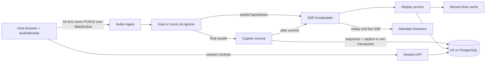

# CaptionBridge

CaptionBridge gives attendees a live caption screen on their own devices. A host starts a session, turns on a microphone, and shares a join link or QR code. Attendees join from a browser without an account. When a connection drops, the attendee page resumes from the last final caption it received.

The first version supports one live session, one microphone per session, and multiple attendees. Vosk runs offline after its model is downloaded. The mock provider generates scripted captions for demos.

## Run locally

Install a **JDK 21** and use a current browser with AudioWorklet support. On Linux and macOS, install `unzip` if it is missing. The Maven Wrapper downloads Maven and the build dependencies on its first run.

### Demo mode

```sh
./mvnw spring-boot:run -Dspring-boot.run.profiles=demo
```

On Windows PowerShell, use `./mvnw.cmd spring-boot:run "-Dspring-boot.run.profiles=demo"`.

Open [the host console](http://localhost:8080/host.html), enter a title, and grant microphone permission. Open the join link in a second tab. The mock provider emits scripted captions while the host stream is connected. The host follows the same microphone workflow in both modes.

### Offline recognition with Vosk

1. Download [vosk-model-small-en-us-0.15](https://alphacephei.com/vosk/models/vosk-model-small-en-us-0.15.zip) from the [Vosk model directory](https://alphacephei.com/vosk/models).
2. Unpack it to `models/vosk-model-small-en-us-0.15` inside the project. The model directory should directly contain folders such as `am` and `conf`. Set `CAPTIONBRIDGE_STT_VOSK_MODEL_PATH` to use another directory.
3. Run `./mvnw spring-boot:run` on Linux or macOS, or `./mvnw.cmd spring-boot:run` on Windows. Open the host console and speak into the microphone.

Vosk is the default provider. Set `CAPTIONBRIDGE_STT_PROVIDER=mock` to select scripted captions independently of the active Spring profile. The Google Cloud Speech-to-Text class is a placeholder for a future streaming integration.

### Join from phones

The host page must use `localhost` or HTTPS for microphone access. Phones need a shareable address that resolves to the running app, such as a LAN address for attendees or an HTTPS tunnel for both host and attendees.

For a LAN demo with the host on `localhost`, set `CAPTIONBRIDGE_PUBLIC_BASE_URL=http://<host-lan-ip>:8080` before starting the app. For an HTTPS tunnel or reverse proxy, set it to the HTTPS base URL. The join link and QR code both use this setting. If the proxy terminates TLS and forwards traffic to the app, enable `SERVER_FORWARD_HEADERS_STRATEGY=framework` only behind a trusted proxy that replaces incoming forwarded headers. Configure the proxy to pass WebSocket upgrades and stream SSE without buffering.

## Docker

Start the app in mock mode with Docker Engine and Docker Compose v2.

```sh
docker compose up --build
```

Open [the host console](http://localhost:8080/host.html). Compose stores H2 data in the `captionbridge-data` volume. `docker compose down` stops the app and retains the volume. Set `CAPTIONBRIDGE_PORT` to change the host port and `CAPTIONBRIDGE_PUBLIC_BASE_URL` to change the public join address.

To run Vosk in Docker, download the model as described above and mount your model directory. Stop the Compose demo first if both use port 8080.

```sh
docker build -t captionbridge .
docker run --rm -p 8080:8080 \
  --mount "type=bind,source=$(pwd)/models,target=/app/models,readonly" \
  --mount "type=volume,source=captionbridge-vosk-data,target=/app/data" \
  captionbridge
```

## Storage and configuration

H2 uses `./data/captionbridge` by default. To use PostgreSQL, create a database, supply the environment variables below, and activate the `postgres` profile. Flyway applies the schema at startup. Enable both `demo,postgres` to use PostgreSQL with scripted captions.

| Environment variable | Purpose |
| --- | --- |
| `SPRING_PROFILES_ACTIVE` | Spring profiles, such as `demo`, `postgres`, or `demo,postgres` |
| `SPRING_DATASOURCE_URL` | JDBC URL, such as `jdbc:postgresql://localhost:5432/captionbridge` |
| `SPRING_DATASOURCE_USERNAME` | Database username |
| `SPRING_DATASOURCE_PASSWORD` | Database password |
| `CAPTIONBRIDGE_STT_PROVIDER` | `vosk` or `mock` |
| `CAPTIONBRIDGE_STT_VOSK_MODEL_PATH` | Path to an unpacked Vosk model |
| `CAPTIONBRIDGE_PUBLIC_BASE_URL` | Public base URL for join links and QR codes |
| `SERVER_FORWARD_HEADERS_STRATEGY` | Forwarded-header handling for a trusted proxy |

## Architecture



### Reconnect and replay

The caption service locks the session row and assigns the next sequence in the same transaction that inserts the final caption. A rollback also rolls back the sequence increment. After commit, the ingest handler publishes an event. Partials use the next expected sequence, remain ephemeral, and carry no SSE event ID.

Every connection has one worker and one cursor. The server registers the connection for notifications before replay starts. The worker sends pages of committed finals after its cursor, using the recent-final cache for a contiguous range and querying the database when the range is missing. It advances only after sending each final. Notifications queued during replay wake the same worker, which reads after that same cursor. A late or redundant notification therefore causes another read without duplicating a caption. The 15-second heartbeat also checks for missed notifications and session status changes.

Final captions use their sequence as the SSE event ID. The server prefers the browser's `Last-Event-ID` header and accepts `?after=` as a fallback. The attendee page discards any caption at or below its cursor and reconnects if it detects a gap. It allows the native EventSource retry first, with exponential backoff and jitter for manual reconnection. A slow connection has a bounded queue. If the queue fills, the server removes the subscriber and interrupts its worker so the client can reconnect from its last received ID.

The version 1 deployment uses a single app instance. Session creation is rate-limited in memory by client address. Keep host tokens private and configure proxy access logs to exclude the WebSocket query string. Anyone with the join URL can read that session's captions while the transcript is retained.

### Try the reconnect demo

1. Start the app in demo mode and open the same join link on two phones or in two independent browser contexts.
2. Wait for both to receive several captions. Disconnect one attendee for about 15 seconds while the other keeps receiving captions.
3. Reconnect the attendee. Look for the reconnecting message to clear and compare the caption order and text on both devices.
4. End the event. Both attendees should display **Event ended**. Download a transcript from the host console, then delete the session if desired.

## API

Host requests use the random token returned once at session creation. The database stores its SHA-256 hash.

| Method and path | Behavior |
| --- | --- |
| `POST /api/sessions` | Accepts `{"title":"Example"}`. Returns `sessionId`, `joinUrl`, and `hostToken`. |
| `GET /api/sessions/{id}` | Returns public session details and status. |
| `POST /api/sessions/{id}/end` | Ends the session. Requires `X-Host-Token`. |
| `DELETE /api/sessions/{id}` | Deletes the session and captions. Requires `X-Host-Token`. |
| `GET /api/sessions/{id}/qr.png` | Returns the join link as a QR PNG. |
| `WS /ws/host/{id}?token=…` | Accepts raw little-endian PCM16 frames up to 32,000 bytes and returns JSON status messages. |
| `GET /api/sessions/{id}/stream` | SSE events `caption`, `partial`, `status`, and `ping`. Resume via `Last-Event-ID` or `?after=`. |
| `GET /api/sessions/{id}/captions?after=0&limit=100` | Returns ordered final captions after the cursor, up to 500 per request. |
| `GET /api/sessions/{id}/export?format=txt` | Downloads TXT, SRT, or VTT. Requires `X-Host-Token`. Subtitle timings are estimated from finalization times. |
| `GET /actuator/health` | Returns application health. |

## Verify and troubleshoot

Run `./mvnw clean verify` with JDK 21. The suite uses H2 and the mock provider, so it runs without a model or microphone. Use `./mvnw.cmd clean verify` on Windows.

| Symptom | Check |
| --- | --- |
| Microphone button reports a permission or insecure-context error | Open the host console on `localhost` or HTTPS and allow microphone access for that site. |
| Host reports that speech recognition is unavailable | Check that the Vosk folder was unpacked correctly. Use the demo profile to check the rest of the setup. |
| Phones cannot open the join link | Check the public base URL, network reachability, and firewall. A phone's `localhost` refers to the phone. |
| Captions arrive in bursts behind a proxy | Disable proxy buffering for the SSE route and check the proxy's idle timeout. |
| Session creation returns `409` | Reopen the original host tab and end its live session. The host tab stores the token in session storage. |
| Session creation returns `429` | Wait up to a minute for the rate limit to reset. |

## Git bootstrap

For a clean checkout without Git history, initialize `main` and commit the files.

```sh
git init -b main
git add .
git commit -m "feat: initialize CaptionBridge"
```

To publish from an authenticated GitHub CLI, create a repository from the checkout and push `main`.

```sh
gh auth login
gh repo create CaptionBridge --private --source=. --remote=origin --push
```

For an existing empty repository, add its URL as `origin` and run `git push -u origin main`. Choose repository visibility when creating it.

A Conventional Commits series for reviewing this build in stages could use:

1. `build: initialize Java 21 Spring Boot project`
2. `feat: persist sessions and sequenced captions`
3. `feat: add offline and mock speech recognition`
4. `feat: ingest host microphone audio over WebSocket`
5. `feat: replay and stream captions over SSE`
6. `feat: add QR sharing and protected transcript exports`
7. `feat: add host and attendee interfaces`
8. `test: verify caption replay and add release tooling`

## Roadmap

- Multiple simultaneous sessions
- Additional Vosk languages and better subtitle timing
- Google Cloud Speech-to-Text streaming provider
- Shared event delivery for multi-instance deployments

Licensed under the [MIT License](LICENSE).
